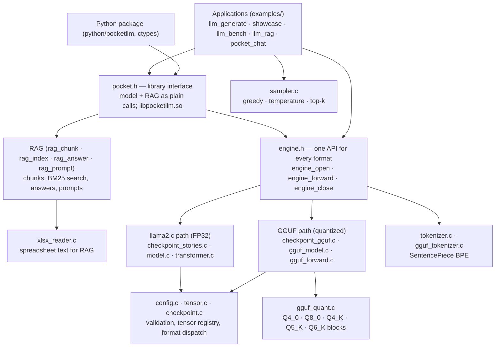

# Architecture and design

## 1. The inference pipeline

Producing one token means running the whole pipeline once. The prompt
tokens go through it one by one, filling the KV cache. After that, every
sampled token is fed back in to produce the next one (autoregressive
generation).

```
 model file ──► loader ──► weights (mmap) ─────────────────────────────┐
                                                                        ▼
 "Once upon" ─► tokenizer ─► token IDs ─► embedding lookup ─► x (dim floats)
                  (BPE)                                                 │
                     ┌──────────────── × n_layers ─────────────────────┤
                     │  RMSNorm ─► Q K V projections ─► RoPE on Q, K    │
                     │         ─► K, V stored in the KV cache           │
                     │         ─► attention over positions 0..pos       │
                     │         ─► output projection ─► + residual       │
                     │  RMSNorm ─► SwiGLU feed-forward ─► + residual    │
                     └──────────────────────────────────────────────────┤
                                                                        ▼
                         final RMSNorm ─► classifier ─► logits (vocab floats)
                                                                        │
          next token ◄── sampler (greedy / temperature / top-k) ◄───────┘
              │
              └──► tokenizer decode ─► text on screen, and fed back in at pos + 1
```

## 2. Layers of the library



| Module | File(s) | Responsibility |
|---|---|---|
| Engine | `engine.c` / `engine.h` | detects the format from the file's first bytes, opens the right path and tokenizer, gives one `engine_forward()` |
| llama2.c loader | `checkpoint_stories.c` | parses the 28-byte header, checks the file is large enough for every tensor, maps the weights |
| Model setup | `model.c` / `llm.h` | `build_transformer()`, run-state allocation, tensor registry, `llm_load()` |
| FP32 forward pass | `transformer.c` | `rmsnorm`, `softmax`, `matmul` (OpenMP), RoPE, attention, SwiGLU, `forward()` |
| GGUF parser | `checkpoint_gguf.c` | header, metadata key/value pairs, tensor directory, alignment, LLaMA config keys |
| GGUF model | `gguf_model.c` / `gguf_model.h` | binds tensor names to layer weights, checks shapes and bounds, row dequantisation, fused `gguf_matvec()` |
| Quant formats | `gguf_quant.c` / `gguf_quant.h` | bit layouts of the GGML block types; FP16 → FP32 |
| GGUF forward pass | `gguf_forward.c` | the same maths as `transformer.c`, using quantized matrix-vector products |
| Tokenizer | `tokenizer.c`, `gguf_tokenizer.c` | loads `tokenizer.bin` or GGUF vocabulary; BPE encode, decode, special tokens, byte fallback |
| Sampler | `sampler.c` | turns logits into a token ID |
| Validation | `config.c`, `tensor.c`, `checkpoint.c` | config sanity checks, generic tensor descriptors, format dispatch |
| RAG input | `xlsx_reader.c` | reads `.xlsx` workbooks (ZIP + XML) into clean cell text |
| RAG chunking | `rag_chunk.c` | folder scan, CSV, header/title detection, one chunk per row, live change detection |
| RAG search | `rag_index.c` | terms, stemming, short forms, typo correction, BM25 |
| RAG answers | `rag_answer.c` | answers straight from the rows, with follow-ups and offers |
| RAG prompts | `rag_prompt.c` | retrieved rows → chat prompt within the context budget |
| Library interface | `pocket.c` / `pocket.h` | model + RAG as plain C calls returning strings; built as `libpocketllm.so` for Python |

### Design decisions

- **One public entry point, two back ends.** Programs use `engine.h`
  and never need to know whether the model is FP32 or quantized. Both back
  ends share `Config`, `RunState`, the KV-cache layout, the tokenizer and
  the samplers, so adding a format means adding a loader and a forward
  function only.
- **Format from content, not file name.** A file starting with the bytes
  `GGUF` takes the GGUF path, and anything else is parsed as llama2.c. A
  renamed file still loads correctly.
- **Weights are never copied.** Both formats `mmap()` the file read-only,
  and quantized weights stay quantized. This keeps the load time near zero
  and memory close to the file size (see `MEMORY.md`).
- **Validate before trusting.** Every size read from a file is checked for
  overflow and against the file length before any pointer is formed. A
  corrupt or truncated file is refused with a message and never read out of
  bounds (the tests feed 12 kinds of corrupt header, truncated files and
  random bytes).
- **No hidden global state.** Everything lives in the handle, so several
  models can be open at once (this is tested).
- **Errors are values.** Functions return `NULL`, `0` or `-1` and write
  into a caller-supplied `char *error` buffer. The library never prints,
  exits or aborts.

## 3. Data structures

### `Config` (`transformer.h`)
The model's shape: `dim`, `hidden_dim`, `n_layers`, `n_heads`, `n_kv_heads`,
`vocab_size`, `seq_len`, plus the LLaMA parameters `rope_dim`,
`rope_freq_base`, `rms_norm_eps` and `rope_scale`. It is read from the
llama2.c header or from GGUF metadata (`llama.embedding_length`,
`llama.block_count` and so on), then checked by `config_validate()`.
For example, `dim` must be divisible by `n_heads`, and `n_heads` by
`n_kv_heads`.

### `TransformerWeights` (`transformer.h`): FP32 path
Twelve `float *` pointers into the mapped file: the token embedding table,
per-layer arrays for the attention RMSNorm, `wq`, `wk`, `wv`, `wo`, the FFN
RMSNorm, `w1`, `w2` and `w3`, then the final RMSNorm and the classifier
`wcls`. In llama2.c files the classifier can share the embedding table; a
negative `vocab_size` in the header marks a separate classifier.

### `GGUFModel` / `GGUFWeight` / `GGUFLayer` (`gguf_model.h`): GGUF path
`GGUFWeight` describes one stored matrix: a `data` pointer into the
mapping, the GGML `type`, `rows`, `cols` and `row_bytes`. Row `r` starts at
`data + r * row_bytes`. A `GGUFLayer` holds the nine weights of one block,
and `GGUFModel` owns the mapping, the parsed tensor directory and the layer
array. `output_is_tied` is set when the file has no `output.weight` and
the embedding table doubles as the classifier.

### `RunState` (`transformer.h`): the per-token working memory
| Buffer | Size (floats) | Purpose |
|---|---|---|
| `x` | dim | the residual stream (current activation) |
| `xb`, `xb2` | dim | normalised input / attention output scratch |
| `hb`, `hb2` | hidden_dim | the two FFN branches |
| `q`, `k`, `v` | dim, kv_dim, kv_dim | projections for the current token |
| `att` | n_heads × seq_len | attention scores |
| `logits` | vocab_size | output of the classifier |
| `key_cache`, `value_cache` | n_layers × seq_len × kv_dim each | the **KV cache** |

The KV cache stores every earlier token's keys and values. Each step then
only computes K and V for the new token and attends over the stored ones,
which makes generation O(pos) per token instead of O(pos²).

### `Tokenizer` (`tokenizer.h`)
`vocab` (one string per token ID), `scores` (merge priority), and
`sorted_vocab`, an array of (string, ID) pairs sorted by string so that
`bsearch()` looks a piece up in O(log V). It also holds `byte_ids[256]`
for byte fallback (any byte is encodable even if no token contains it),
the BOS/EOS IDs and the special-token list (`<s>`, `</s>`,
`<|assistant|>` …) for GGUF chat models.

### `LLMModel` (`engine.c`, opaque)
The detected `LLMFormat` tag, both back-end structs (`Transformer` and
`GGUFTransformer`, only the one matching the tag is used), the
`Tokenizer`, the file's own context length and the description string. It is opaque, so callers only reach it
through `engine.h`.

### `Tensor` (`transformer.h`)
A generic descriptor (name, data pointer, dtype, storage kind, shape) kept
in a registry, so tools can list and look up a model's tensors by name
regardless of format.

### RAG structures (`rag_chunk.h`, `rag_index.h`, `rag_answer.h`)
- `RagCorpus` (opaque): every loaded file, its tables and its chunks,
  plus the file sizes and times used to notice changes.
- `RagChunk`: one row, or a merged run of rows, with `file`, `sheet`,
  `title`, Excel row numbers and an array of `RagField {label, value, key,
  variant}`; or a note (a footnote line) with how many tabs contain it.
- `RagIndex` (opaque): the term dictionary, a posting list per term
  (chunk, weighted tf), chunk lengths, the average length and idf values,
  plus the short-form `~` terms and label words.
- `RagHit {chunk, score}`: one search result.
- `RagQueryTerm {term, typed, kind, is_label}`: a question word and how it
  was resolved (exact, short form, corrected, unknown).
- `RagSession` (opaque): the conversation state for `--retrieve-only`,
  i.e. the current row, the pending offer and the numbered choices.

### `PocketModel` / `PocketRag` (`pocket.h`)
Opaque handles that wrap an `LLMModel` plus its chat history and KV-cache
position, and a corpus + index + session respectively. Returned strings
live in buffers inside the handle, which is what makes the API easy to call
from Python through ctypes.

### `XlsxBook` / `XlsxRow` (`xlsx_reader.h`)
A parsed workbook: its sheets (name, hidden flag), and per sheet the
non-empty rows, each with its Excel row number and an array of cell strings.
All strings live in one arena owned by the book.

## 4. Extending the system

| To add… | Change |
|---|---|
| a new quantization type | a block decoder in `gguf_quant.c`, plus its case in `gguf_weight_dequantize_row()` / `gguf_matvec()` |
| a new model file format | a loader that fills `Config` and the weights, plus one branch in `engine_open()` / `engine_forward()` |
| a new sampler (e.g. top-p) | one function in `sampler.c` with the same signature style, plus a CLI option |
| a new document type for RAG (e.g. PDF text) | a reader that produces tables or notes for `rag_chunk.c`; indexing and answering are unchanged |
| a binding for another language | wrap the functions of `pocket.h` the way `python/pocketllm` does |
| a new architecture variant | metadata keys in `checkpoint_gguf.c` and the changed step in `gguf_forward.c` |
